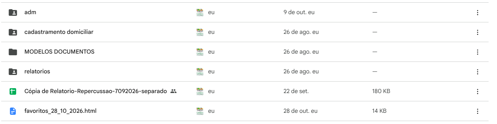

# 00 - Visão Geral do Sistema e Gestão de Acessos

Este documento centraliza as contas, permissões e infraestrutura dos sistemas mantidos no setor do Cadastro Único e Bolsa Família (Prefeitura Municipal de Marília).

---

## 1. Conta Mestra e Repositórios

| Recurso | Identificador / Localização | Responsabilidade |
| :--- | :--- | :--- |
| **E-mail Institucional Google** | `cadunico.marilia.sp@gmail.com` | Dono de todas as planilhas, formulários, arquivos mestre e Apps Scripts. |
| **Repositório Front-end (Fila)** | `https://github.com/Viniciusulpicio/cadunico_recepcao` | Código HTML/JS do Painel de Fila hospedado no GitHub Pages. |
| **Página Web em Produção** | `https://viniciusulpicio.github.io/cadunico_recepcao/` | Interface visual acessada pelos entrevistadores e recepção. |

### Estrutura de Pastas Raiz no Google Drive

Todas as ferramentas operam a partir das pastas principais:
- `adm`: Sistema de fichas e processos do Bolsa Família.
- `cadastramento domiciliar`: Agendamento, roteirização e termos de CD.
- `relatorios`: Gestão mensal consolidada e histórico de fechamento.
- `MODELOS DOCUMENTOS`: Modelos para duplicação.

---

## 2. Mapa dos Quatro Módulos do Sistema

1. **Painel de Fila / Recepção (`cadunico_recepcao`)**
   - Comunicação via Web App entre a recepção e os entrevistadores de 3 postos (Central, Teotônio Vilela, Rosa Modelli).
2. **Administração de Benefícios (`adm`)**
   - Google Forms + Script de geração de processos administrativos em PDF mesclado com documentos comprobatórios.
3. **Cadastramento Domiciliar (`cadastramento domiciliar`)**
   - Google Forms + Script de geração de termos em PDF + Roteirizador geográfico com algoritmo 2-opt + Disparador WhatsApp.
4. **Relatórios e Gestão Mensal (`relatorios`)**
   - Consolidação de atendimentos mensais, congelamento de histórico e mecanismo de busca por CPF/Nome.

---

## 3. Serviços Externos e Dependências de Execução

- **Google Apps Script nativo:** Todos os scripts de backend usam tempo de execução V8 sob a conta Google do CadÚnico.
- **Geocodificação:** Utiliza o serviço interno do Google Workspace (`Maps.newGeocoder()`). **Não requer chave de API nem fatura no Google Cloud.**
- **Mesclagem de PDFs (pdf-lib):** Os scripts carregam a biblioteca `pdf-lib` via CDN (`https://cdn.jsdelivr.net/npm/pdf-lib/dist/pdf-lib.min.js`) em tempo de execução para concatenar o documento base preenchido com as fotos/arquivos enviados nos formulários.

---

## 4. Onde Configurar Permissões para Novos Funcionários

1. **Acesso às Planilhas e Drives:**
   - Acesse o Google Drive com a conta `cadunico.marilia.sp@gmail.com`.
   - Compartilhe as pastas raiz e planilhas com nível de **Editor** apenas para quem for operar a triagem ou administrativo.
2. **Reimplantação de Scripts (Deploy):**
   - Toda alteração em código de Web App (`cadunico_recepcao`) exige que a implantação seja feita como:
     - **Executar como:** Eu (`cadunico.marilia.sp@gmail.com`)
     - **Quem tem acesso:** Qualquer pessoa (*Anyone*)
