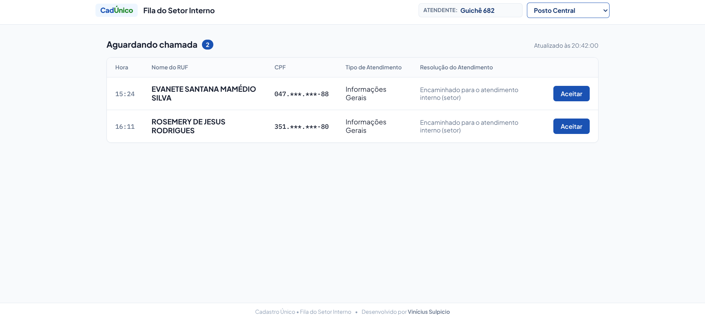
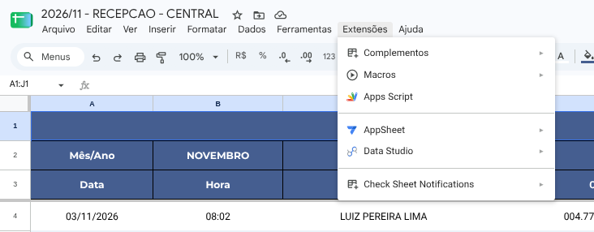
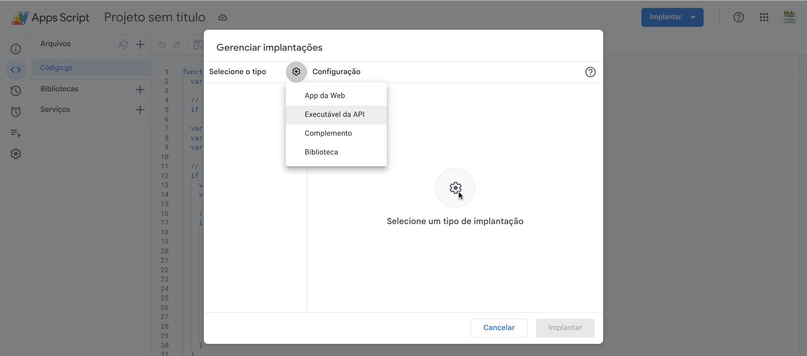
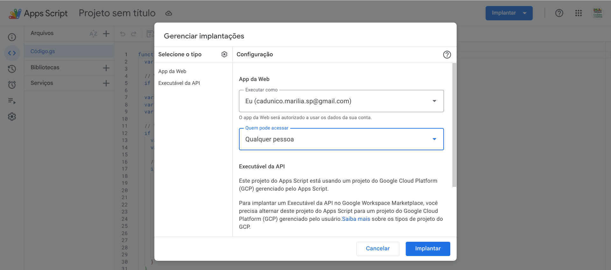
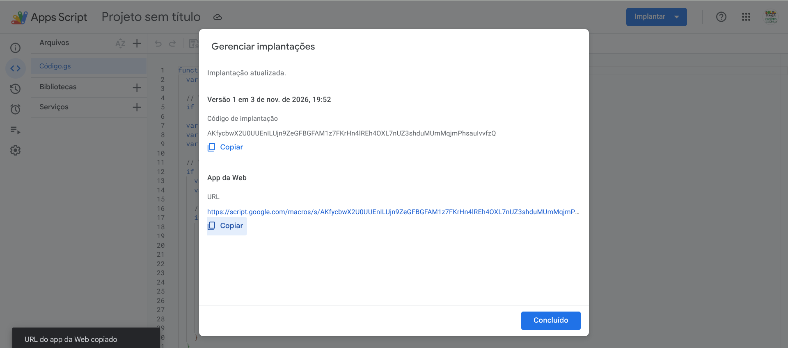
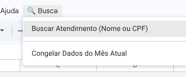
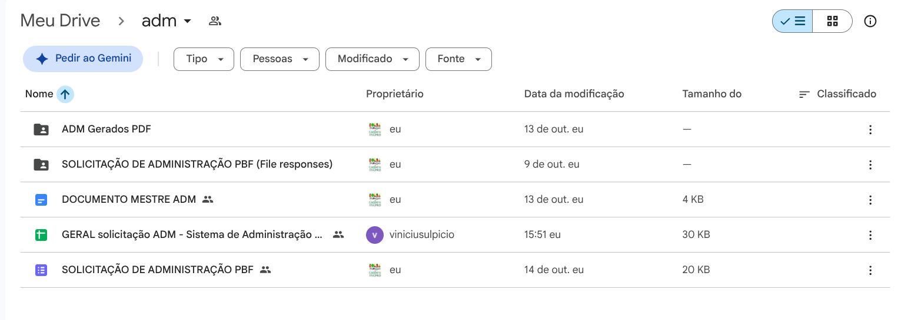

# 01 - Painel de Recepção e Fila de Atendimento

Este guia descreve como operar, manter e configurar novas planilhas para o painel de fila web dos entrevistadores e recepção.

---

## 1. Arquitetura da Solução

- **Interface Frontend (Web):** Hospedada no GitHub Pages (`https://viniciusulpicio.github.io/cadunico_recepcao/`).
- **Backend (API):** Google Apps Script implantado como Web App a partir de [`cadunico_recepcao/Codigo.gs`](file:///home/vinicius/temp/cad/cadunico_recepcao/Codigo.gs).
- **Banco de Dados / Armazenamento:** Planilha Google do posto (contendo a aba `RECEPÇÃO MENSAL`).

### Visão da Tela do Entrevistador (Web)

Na tela acima:
- O entrevistador seleciona seu guichê e posto (ex: *Posto Central*).
- A lista de pessoas aguardando exibe Nome, CPF mascarado, Tipo de Atendimento e o botão **Aceitar**.
- Ao clicar em **Aceitar**, o entrevistador chama o cidadão e a planilha é atualizada em tempo real.

---

## 2. Regra de Negócio e Mudança de Status

A planilha possui as seguintes colunas de triagem e controle:
- **Coluna G (7):** *Resolução do Atendimento*. Quando a recepção preenche com `"Encaminhado para o atendimento interno (setor)"`, a linha entra na fila.
- **Coluna K (11):** *Status Fila* (`AGUARDANDO` | `EM_ATENDIMENTO` | `FINALIZADO`).
- **Coluna L (12):** *Entrevistador Responsável*.
- **Coluna M (13):** *Hora Aceite* (início).
- **Coluna N (14):** *Hora Finalização* (término).

Quando o entrevistador clica em **Aceitar** no painel web, o Web App grava seu nome na coluna L, marca K como `EM_ATENDIMENTO` e anota o horário em M. Ao clicar em **Finalizar**, o status vai para `FINALIZADO` com horário em N.

### Devolução para a Fila (2 Possibilidades):
Ao clicar no botão **Devolver para a fila**, uma janela permite escolher entre:
1. **Peguei por engano:** Devolve o cidadão de volta para a fila (`AGUARDANDO`), limpando o entrevistador e o horário de aceite, mantendo os dados exatamente iguais.
2. **Atendimento incorreto / Redirecionar:** Quando o cidadão solicitou um serviço diferente do que precisa:
   - Finaliza o registro atual com o nome do entrevistador e hora de término (`FINALIZADO`).
   - Duplica a passagem para uma nova linha na planilha com status `AGUARDANDO`, preservando os dados cadastrais e o mesmo horário de chegada original, porém atualizando o **Tipo de Atendimento** selecionado entre os **16 tipos oficiais da planilha**:
     1. `Inclusão Cadastral`
     2. `Atualização Cadastral`
     3. `Exclusão da Familia`
     4. `Solicitação Administração do Bolsa Familia`
     5. `Emissão Comprovante CadÚnico`
     6. `Emissão da Carteira da Pessoa Idosa`
     7. `Encaminhamento`
     8. `Solicitação de Atendimento Domiciliar`
     9. `Informações Gerais`
     10. `Não cumprimento de condicionalidades PBF - CRAS`
     11. `Solicitação Desligamento Voluntário PBF`
     12. `Atendimento Telefônico`
     13. `Encaminhamento para outros setores ou políticas publicas`
     14. `WhatsApp - Resposta à Família`
     15. `WhatsApp - Comunicado à Família`
     16. `WhatsApp - Aviso Prévio de CD`

---

## 3. Passo a Passo Visual: Criar Nova Planilha (Troca Mensal/Anual)

> **Regra de Ouro:** **SEMPRE DUPLIQUE** a planilha do mês anterior ou use a pasta `relatorios/modelos originais/` (Botão direito → **Fazer uma cópia**). Ao duplicar, **todo o código do Apps Script e os menus já vão juntos automaticamente**.

### Etapa 1: Abrir o Apps Script da Planilha Nova
Após duplicar e renomear a planilha do novo mês (ex: `2026/11 - RECEPCAO - CENTRAL`), abra o menu **Extensões → Apps Script**:

*Dica prática:* Duplicar diretamente a planilha do mês anterior do próprio setor é o caminho mais rápido, pois você só precisa apagar as linhas dos cidadãos atendidos. Os nomes dos servidores, os guichês e as configurações individuais já permanecem todos preenchidos.

### Etapa 2: Acessar o Menu de Implantação
No canto superior direito do editor Apps Script, clique no botão azul **Implantar → Gerenciar implantações** (ou Nova implantação):

### Etapa 3: Selecionar o Tipo "App da Web"
Clique no ícone de engrenagem ao lado de "Selecione o tipo" e escolha **App da Web**:

### Etapa 4: Configurar Acesso Obrigatório
Configure as opções exatamente assim:
- **Executar como:** `Eu (cadunico.marilia.sp@gmail.com)`
- **Quem pode acessar:** `Qualquer pessoa`

### Etapa 5: Copiar a Nova URL do App da Web
Clique no botão azul **Implantar** e depois clique em **Copiar** no campo *URL do App da Web* (terminada em `/exec`):

### Etapa 6: Atualizar a Planilha Central de Postos
Abra a planilha `Config_Postos_CadUnico` e cole a nova URL na linha correspondente ao posto (`central`, `teotonio` ou `rosa_modelli`):

