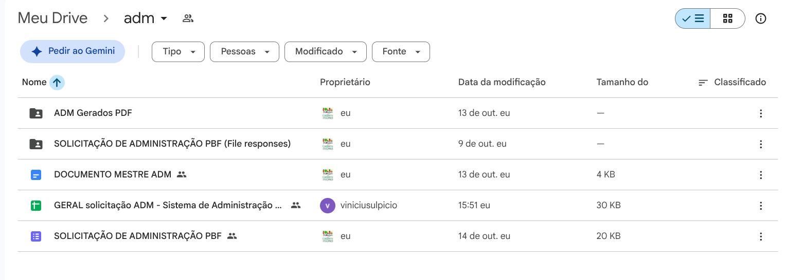
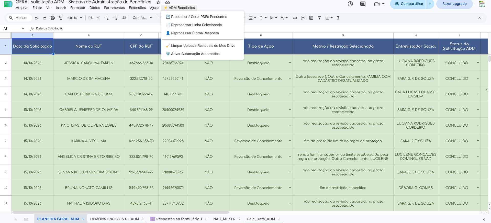

# 02 - Sistema de Administração de Benefícios (ADM / PBF)

Este módulo automatiza a formalização de solicitações administrativas do Bolsa Família, convertendo dados de formulário e uploads de comprovantes em um PDF único oficializado.

---

## 1. Identificadores Mestres no Google Drive (`cadunico.marilia.sp@gmail.com`)

| Recurso | ID do Google Drive | Nome do Arquivo / Pasta |
| :--- | :--- | :--- |
| **Formulário de Entrada** | `1DklceLhUiChBQz9ny_BWDs7xAiCu5Bu1QhAZd7d6ICY` | SOLICITAÇÃO DE ADMINISTRAÇÃO PBF |
| **Documento Modelo Base** | `11PIzMNnLj31UWo34uVhy2j7PFdJfiGkq4a_bw2y2Mio` | DOCUMENTO MESTRE ADM (Google Docs) |
| **Pasta de Saída (PDFs)** | `1d-w0rT-74nRBfvI_bHUaB84ZBQ1wJ2pH` | ADM Gerados PDF |
| **Planilha Vinculada** | - | GERAL solicitação ADM |

### Organização da Pasta `adm` no Google Drive

---

## 2. Fluxo de Execução do Sistema

1. **Entrada:** O usuário/assistente preenche o Google Forms e anexa documentos (RG, CPF, Comprovante de Residência, Folha Resumo, etc.).
2. **Disparo Automático:** O envio dispara a função `onFormSubmit` no Apps Script associado à planilha.
3. **Preenchimento do Mestre:** O script duplica o `DOCUMENTO MESTRE ADM`, substitui as tags de texto (ex: `{{NOME}}`, `{{CPF}}`, `{{NIS}}`, etc.) pelos dados da resposta.
4. **Conversão e Concatenação:**
   - O documento temporário vira PDF.
   - A biblioteca `pdf-lib` junta este PDF inicial a todos os arquivos enviados nos uploads.
   - O PDF completo é salvo na pasta **ADM Gerados PDF**.
5. **Registro:** O link do arquivo final é gravado na coluna K da aba `PLANILHA GERAL ADM` e na coluna 19 da aba `Respostas ao formulário 1`.

---

## 3. Comandos do Menu no Google Sheets (`⚡ ADM Benefícios`)

- **🔄 Processar / Gerar PDFs Pendentes:** Varre as linhas da planilha que não possuem link de PDF e gera os arquivos pendentes.
- **📄 Reprocessar Linha Selecionada:** Gera novamente o documento referente à linha onde o cursor está posicionado.
- **👤 Reprocessar Última Resposta:** Força o processamento imediato do último envio.
- **⚙️ Ativar Automação Automática:** Executa `instalarGatilhoAutomatico()`, garantindo que o gatilho de formulário esteja ativo se for excluído por engano.
- **🧹 Limpar Uploads Residuais:** Organiza os arquivos de upload que ficam soltos na raiz do Drive.
