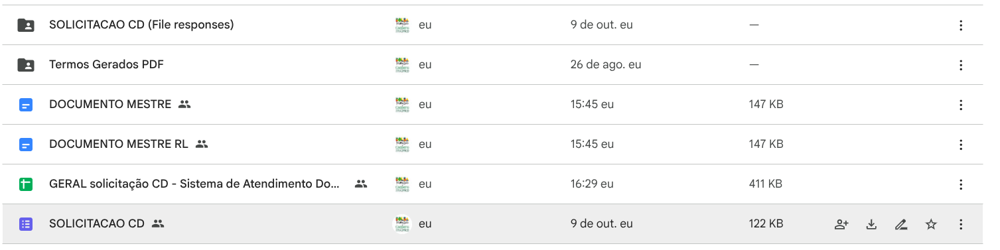
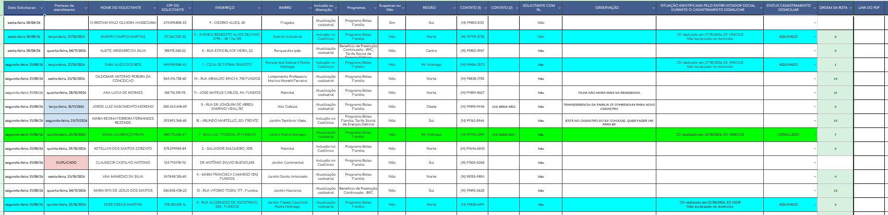
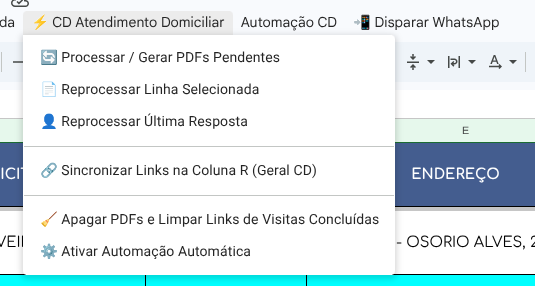
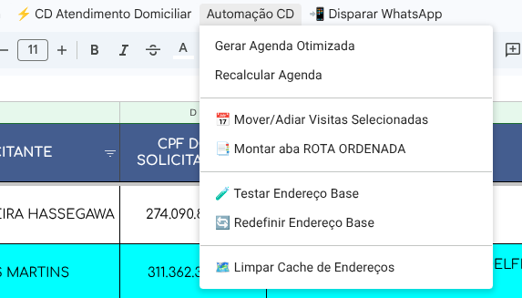
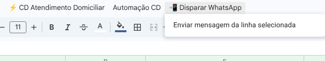

# 03 - Sistema de Cadastramento Domiciliar (CD)

O módulo de Cadastramento Domiciliar atende pessoas acamadas, idosos ou pessoas com deficiência sem condições de comparecer aos postos. Ele engloba geração de termos em PDF, roteirização geográfica inteligente de visitas e disparo de notificações via WhatsApp.

---

## 1. Identificadores no Google Drive (`cadunico.marilia.sp@gmail.com`)

| Recurso | ID Google Drive | Descrição |
| :--- | :--- | :--- |
| **Doc Mestre Padrão** | `1SC3thHpexLTFnz1wAC-KsV9BByIK83AdlwUph1MVmXI` | Termo para Titular / Beneficiário capaz |
| **Doc Mestre Representante Legal** | `17tCn8cT6sq_AKU9YCnA-p__IlzhFTMNA0Mi6nfE5G6Q` | Termo para Tutela / Curatela / RL |
| **Pasta de Saída dos Termos** | `1pSg_3wGWIC3ow14QdtoTNsnPXWycw5kx` | Termos Gerados PDF |
| **Planilha Central** | - | GERAL solicitação CD |

### Organização da Pasta de Cadastramento Domiciliar no Drive

---

## 2. Operação da Planilha Central (`PLANILHA GERAL CD`)

A planilha contém colunas automáticas de controle operacional:
- **Previsão de Atendimento:** Data programada pelo roteirizador.
- **Situação Identificada / Status:** `CONCLUIDO` (destaque verde), `AQUIVADO` (destaque ciano) ou `DUPLICADO` (destaque rosa/vermelho).
- **Ordem da Rota:** Posição exata que o motorista/entrevistador deve seguir no dia (1 a 14).
- **Link do PDF:** Link direto do documento termo já mesclado na pasta do Drive.

---

## 3. Menus de Operação do Cadastramento Domiciliar

### Menu 1: Geração de Termos e Gatilhos (`⚡ CD Atendimento Domiciliar`)

- **Processar / Gerar PDFs Pendentes:** Cria os termos pendentes.
- **Sincronizar Links na Coluna R:** Reconecta os links dos PDFs criados na planilha geral.
- **Apagar PDFs e Limpar Links de Visitas Concluídas:** Limpa os PDFs pesados de casos já atendidos para economizar a cota de 15 GB do Google Drive.
- **Ativar Automação Automática:** Reativa os disparadores automáticos ao receber novos cadastros.

### Menu 2: Roteirizador Inteligente (`Automação CD`)

- **Gerar Agenda Otimizada:** Agrupa as visitas pelo bairro mais distante da base (`Rua Nelson Spielman, 1294`) e calcula a rota mais curta do dia (máximo 14 na cidade ou 8 no distrito).
- **Recalcular Agenda:** Ajusta as datas de visitas pendentes.
- **Mover/Adiar Visitas Selecionadas:** Permite reprogramar manualmente visitas marcadas.
- **📑 Montar aba ROTA ORDENADA:** Cria uma folha pronta para impressão para entregar ao motorista e entrevistador com os endereços na sequência exata de viagem.
- **Limpar Cache de Endereços:** Limpa a aba `GeoCache` se algum endereço foi atualizado.

### Menu 3: Disparo de Notificação no WhatsApp (`📲 Disparar WhatsApp`)

1. Clique na linha do cidadão agendado.
2. Acesse: **📲 Disparar WhatsApp → Enviar mensagem da linha selecionada**.
3. Clique em **📲 Abrir no WhatsApp Web** na barra lateral.
4. O chat abrirá com a data, horário aproximado e a lista dos documentos que a família deve deixar em mãos.

---

## 4. Preenchimento Automatizado do Formulário Verde F1 (com `pdf-lib`)

O sistema conta com rotina vetorial em Apps Script (`formulario_verde/codigo_apps_script.gs`) que gera o dossiê oficial desenhando os dados cadastrais diretamente sobre as coordenadas vetoriais do PDF oficial em folha A4 paisagem (`FORMULARIO VERDE F1.pdf` do Governo Federal, ID `1M1MzdRQ1QFCwdOv4U0DF2XovNLpIpWqF`), posicionando o **Formulário Verde como a Página 1** do dossiê:

### Estrutura e Ordem das Páginas no Dossiê Final
1. **Página 1 (Frente Oficial): Formulário Verde F1** com dados preenchidos a laser nos campos milimétricos.
2. **Página 2: Termo de Atendimento Domiciliar** (gerado a partir do Google Docs mestre, com substituição de tags `{{NOME}}`, `{{CPF}}`, `{{X_BPC}}`, etc.).
3. **Páginas Centrais: Anexos Comprobatórios** enviados no formulário de atendimento domiciliar, convertidos e ordenados:
   1. Folha Resumo (PDF)
   2. Xerox Doc Identidade (RG, CPF, CNH ou Certidão)
   3. Xerox Tutela, Curatela ou Procuração (quando houver)
   4. Xerox Comprovante de Residência (quando houver)
   5. Tela / Extrato do CNIS (quando houver)
   6. Consulta SIBEC (quando houver)
   7. Comprovante da Receita Federal
   8. Outros Documentos 1 (se houver)
   9. Outros Documentos 2 (se houver)
   10. Outros Documentos 3 (se houver)
4. **Páginas Finais: Folhas de Continuação do Termo Domiciliar** (páginas 2 e 3 do Documento Mestre: declaração de residência e responsabilidade legal).

### Regras de Preenchimento do Formulário Verde
1. **Recibo Superior:**
   - **Nome:** Inicia após `"Eu, "` em $X=250.0$, assentado rente à linha impressa em $Y=540.0$ (`size: 9.5`, negrito).
   - **Local:** Centralizado exatamente sobre a linha em $X=346.5 - (\text{largura} / 2)$, $Y=504.5$, formatado em caixa alta e negrito (`MARÍLIA`, `size: 9.5`).
   - **Data do Recibo / Assinatura:** Mantidas em branco para preenchimento manual no momento da visita.
2. **Identificação do Titular (Bloco 1):**
   - **Nome do Titular:** Centralizado letra a letra nas caixinhas com passo calibrado de $11.33\text{ pt}$ (linha 1 com 32 posições e linha 2 para continuidade de sobrenomes longos sem encostar nas divisórias).
   - **CPF:** 9 dígitos iniciais centralizados nas caixas individuais ($X=246.25$, passo $11.35\text{ pt}$) e os 2 dígitos verificadores após o traço ($X=359.50$, passo $11.5\text{ pt}$).
   - **Nome do Município:** Preenchido como `MARILIA` (sem acento, caixa alta), com cada letra centralizada nas caixas e assentada no fundo da grade ($X=298.3$, passo $11.33\text{ pt}$, $Y=185.0$).
3. **Painéis Inferiores:**
   - **Código Familiar:** 11 dígitos preenchendo exatamente as 11 caixinhas de ponta a ponta ($X=165.35$, passo $11.30\text{ pt}$, baseline $Y=136.5$).
   - **Data da Entrevista e Identificação do Entrevistador:** Omitidas conforme norma operacional (preenchimento manual no ato).
   - **Telefone do Órgão Responsável:** Centralizado no retângulo branco em $X=357.6 - (\text{largura} / 2)$ e $Y=85.3$, fixado com o telefone oficial do CadÚnico: `(14) 3434-1840` (`size: 10.5`, negrito).
   - **Modalidade da Operação:** Assinala `X` perfeitamente alinhado no interior do quadradinho branco ($X=163.67$), baseline $Y=93.8$ para `Inclusão` ou $Y=80.0$ para `Alteração`.

---

## 5. Limpeza em Cascata de Arquivos e Gestão de Cota (15 GB)

Para evitar o esgotamento do armazenamento gratuito do Google Drive:

1. **Gatilho Imediato (`aoEditarStatus`):** Quando a situação de uma visita é alterada para `CONCLUIDO` ou `ARQUIVADO` na coluna P da `PLANILHA GERAL CD`, o script move para a lixeira tanto o PDF final mesclado quanto todos os arquivos originais de upload vinculados na aba `forms`.
2. **Rotina Noturna Diária (02:00):** O gatilho temporal `limparArquivosVisitasConcluidas` executa todas as noites às 02:00 para conferir e expurgar arquivos de quaisquer linhas finalizadas que tenham restado com link ativo.
