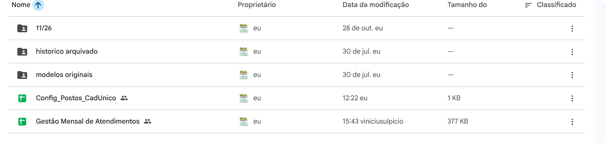
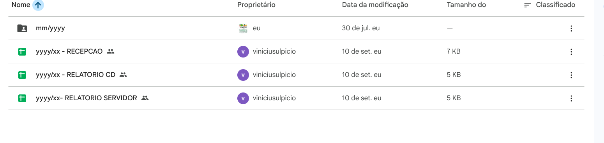
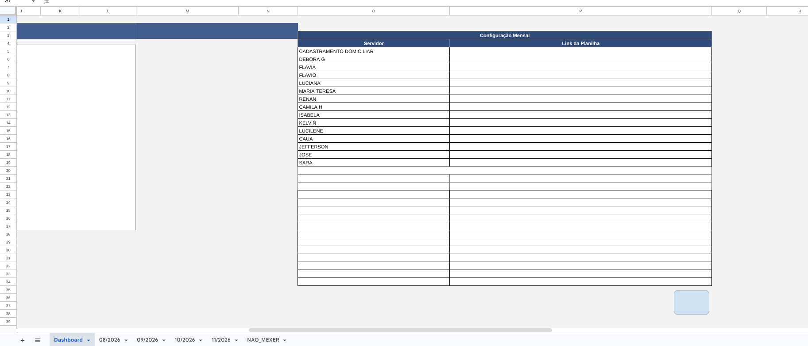
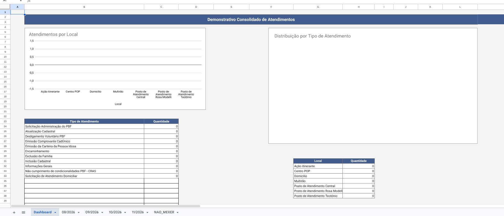
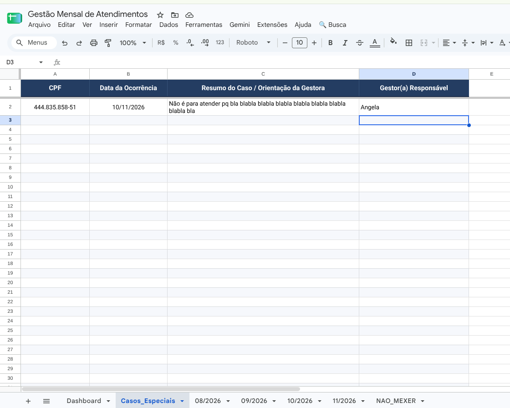
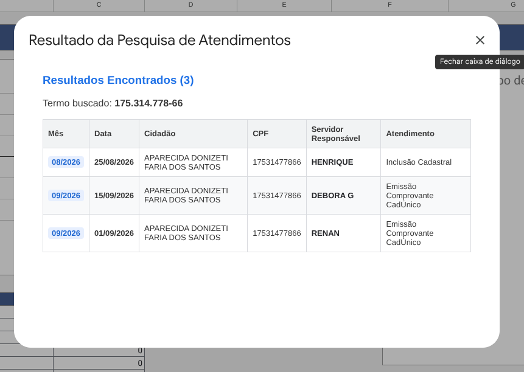
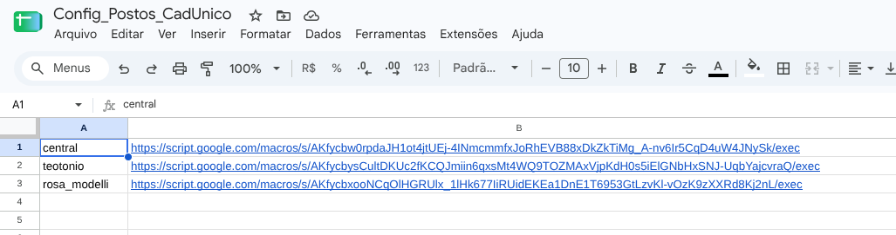

# 04 - Relatórios de Servidores, Fechamento Mensal e Busca

Este módulo documenta a criação mensal das planilhas de produção individual dos servidores (`RELATORIO SERVIDOR` e `RELATORIO CD`) e a consolidação estatística na planilha mestre `Gestão Mensal de Atendimentos`.

> **Importante — Diferença entre Fila (Recepção) e Relatórios:**  
> Embora fiquem organizadas dentro da pasta `relatorios` no Google Drive, as planilhas funcionam de formas distintas:
> - **Planilhas de Fila (`yyyy/xx - RECEPCAO` + `Config_Postos_CadUnico`):** Alimentam o site da fila de espera dos 3 postos e **exigem Implantação como App da Web** no Apps Script (ver [Módulo 01](01-painel-recepcao-e-fila.md)).
> - **Planilhas de Relatório (`yyyy/xx - RELATORIO SERVIDOR`, `yyyy/xx - RELATORIO CD` e `Gestão Mensal de Atendimentos`):** Registram a produção estatística mensal de cada entrevistador/técnico e **não precisam de implantação Web App** — basta duplicar na virada do mês e vincular o link na aba `Configuração Mensal`.

---

## 1. Estrutura da Pasta `relatorios` e Modelos Originais



Dentro da pasta `relatorios` do Google Drive:
- **`Gestão Mensal de Atendimentos`:** Painel mestre consolidado de estatísticas e busca por CPF/Nome.
- **`modelos originais`:** Pasta com as planilhas matrizes oficiais para duplicação mensal:
  - `yyyy/xx - RELATORIO SERVIDOR` *(produção individual de cada entrevistador/técnico)*
  - `yyyy/xx - RELATORIO CD` *(produção de visitas domiciliares)*
  - `yyyy/xx - RECEPCAO` *(exclusiva para a recepção/fila do posto — ver Módulo 01)*



---

## 2. Virada de Mês dos Relatórios dos Servidores e Dashboard

1. **Duplicar as Planilhas dos Servidores:**
   - Na virada do mês, duplique a pasta do mês anterior (ou os modelos `RELATORIO SERVIDOR` / `RELATORIO CD`) para cada servidor de cada unidade (Central, Rosa Modelli e Teotônio Vilela) e limpe os registros do mês encerrado.
2. **Vincular na Aba `Configuração Mensal`:**
   - Abra a planilha mestre `Gestão Mensal de Atendimentos` na aba `Configuração Mensal` e cole o link da nova planilha mensal de cada servidor na linha correspondente:
   
3. **Conferir o Dashboard Consolidado:**
   - A aba `Dashboard` passa a somar automaticamente os atendimentos realizados por local (Central, Rosa Modelli, Teotônio Vilela, Domicílio, Ação Itinerante, etc.) e por tipo de serviço:
   

---

## 3. Gestão Centralizada de Casos Especiais (Aba `Casos_Especiais`)

A planilha mestre `Gestão Mensal de Atendimentos` centraliza as diretrizes da coordenação para munícipes que exigem tratamento diferenciado, bloqueio temporário ou orientações especiais:



### Estrutura de Colunas:
- **Coluna A:** `CPF` (com ou sem pontuação).
- **Coluna B:** `Data da Ocorrência` (data de inclusão da determinação).
- **Coluna C:** `Resumo do Caso / Orientação da Gestora` (detalhamento da conduta que a recepção deve adotar).
- **Coluna D:** `Gestor(a) Responsável` (nome da autoridade que registrou a orientação, ex: *Angela*).

Todas as planilhas `RECEPCAO` dos postos leem essa aba via `IMPORTRANGE` em tempo real. Sempre que um CPF listado for inserido na recepção, a tela exibe o alerta com a orientação antes de prosseguir com o atendimento.

---

## 4. Rotina Crítica: Congelamento do Mês Encerrado

As abas mensais da `Gestão Mensal de Atendimentos` utilizam fórmulas dinâmicas para puxar os dados das planilhas do mês. Ao final de cada mês, é **obrigatório congelar** a aba encerrada antes de arquivar as planilhas:

1. Abra a aba do mês recém-encerrado (ex: `10/2026`).
2. Clique no menu superior: **🔍 Busca → Congelar Dados do Mês Atual**.

3. Confirme a caixa de diálogo clicando em **Sim**.
4. O script converterá as fórmulas do intervalo `Z4:AH` em valores estáticos (texto puro), preservando o histórico permanentemente e mantendo a planilha rápida.

---

## 5. Como Adicionar Novos Meses na Ferramenta de Busca

A função de busca por Nome/CPF pesquisa em uma lista de abas. Quando um novo mês for criado na `Gestão Mensal de Atendimentos`:

1. Abra a planilha e vá em **Extensões → Apps Script**.
2. Abra o arquivo `codigo.gs` e localize a linha ~58:
   ```javascript
   var abasMensais = ['08/2026', '09/2026', '10/2026'];
   ```
3. Adicione o novo mês à lista (ex: `['08/2026', '09/2026', '10/2026', '11/2026']`).
4. Salve o script (`Ctrl + S`).

---

## 6. Como Operar a Busca Geral e Auditoria LGPD

1. Clique no menu **🔍 Busca → Buscar Atendimento (Nome ou CPF)**.
2. Digite o nome (completo ou parcial) ou os números do CPF (com ou sem pontuação).
3. Uma janela modal listará todos os registros correspondentes com: Mês, Data, Nome, CPF, Servidor e Tipo de Atendimento:


> **Auditoria Obrigatória (LGPD / Portaria MDS nº 502/2017):**  
> Toda pesquisa executada gera automaticamente um registro na aba `AUDITORIA_CONSULTAS` com a data/hora, o e-mail do servidor que realizou a consulta, o termo pesquisado e a quantidade de resultados retornados. Isso garante a rastreabilidade contra consultas particulares indevidas.
