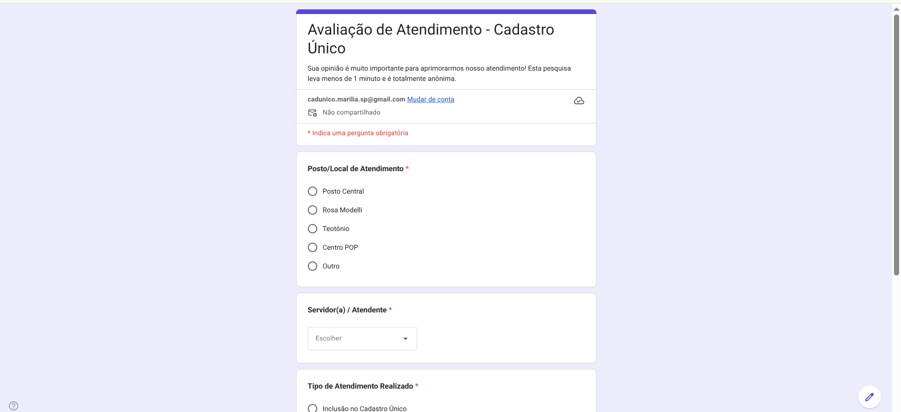
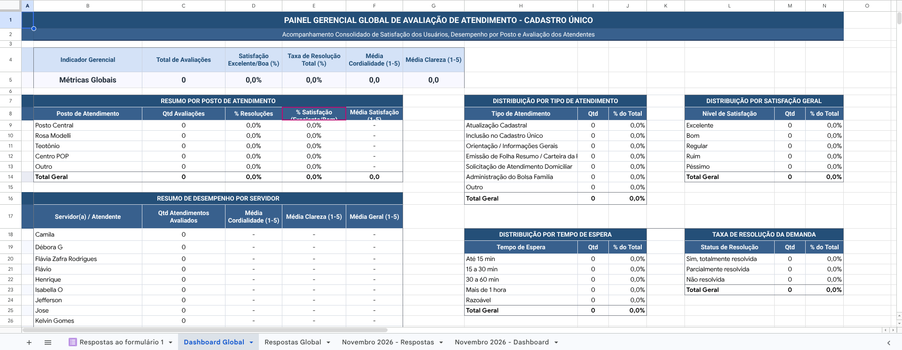
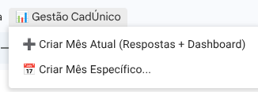

# 05 - Sistema de Avaliação de Atendimento e Desempenho dos Atendentes

Este módulo automatiza a coleta e análise da satisfação dos cidadãos atendidos nos postos do Cadastro Único de Marília, gerando painéis mensais e globais de desempenho por servidor e por posto.

---

## 1. Formulário de Avaliação Respondido pelo Cidadão

O cidadão responde à pesquisa rápida e anônima no celular ou tablet disponibilizado no guichê:

A pesquisa avalia:
- Posto / Local de Atendimento (Central, Rosa Modelli, Teotônio Vilela, Centro POP, Outro)
- Servidor(a) / Atendente (selecionado em lista suspensa)
- Tipo de Atendimento Realizado
- Tempo de Espera
- Cordialidade e Respeito (nota de 1 a 5)
- Clareza nas Informações (nota de 1 a 5)
- Solicitação Resolvida (Sim, Parcialmente, Não)
- Nível de Satisfação Geral (Excelente, Bom, Regular, Ruim, Péssimo)
- Elogios / Críticas / Sugestões

---

## 2. Painel Gerencial Global e Mensal

A aba `Dashboard Global` (e as abas mensais correspondentes) calculam automaticamente:
- **Métricas Globais:** Total de avaliações, % de satisfação excelente/boa, taxa de resolução e notas médias de cordialidade e clareza.
- **Resumo por Posto:** Total de atendimentos e taxa de resolução de cada unidade.
- **Resumo de Desempenho por Servidor:** Lista de cada entrevistador com quantidade de avaliações recebidas e média individual de notas.
- **Gráficos Auxiliares:** Distribuição por tempo de espera e nível de satisfação geral.

---

## 3. Automação Mensal Automática (`onFormSubmit`)

Quando o cidadão envia a resposta:
1. O gatilho `onFormSubmit` identifica o mês e ano do atendimento (ex: `Novembro 2026`).
2. Se a aba daquele mês ainda não existir, o script cria a aba `[Mês AAAA] - Respostas` com os cabeçalhos formatados e duplica a aba `Dashboard Global` para `[Mês AAAA] - Dashboard`, ajustando as fórmulas para lerem os dados do novo mês.
3. A linha é gravada tanto na aba mensal quanto na aba acumulada `Respostas Global`.

---

## 4. Menu na Planilha (`📊 Gestão CadÚnico`)

- **➕ Criar Mês Atual (Respostas + Dashboard):** Cria com antecedência as abas do mês corrente antes mesmo da primeira resposta entrar.
- **📅 Criar Mês Específico...:** Abre uma janela para digitar manualmente outro mês/ano (ex: `Janeiro 2027`) e gera o par de abas.

---

## 5. Rotina de Manutenção

- **Adicionar Novo Atendente:** Se entrar um novo servidor na equipe, basta editar as opções da pergunta *Servidor(a) / Atendente* no Google Forms.
- **Gatilho de Envio:** Na planilha, vá em **Extensões → Apps Script → Acionadores** e certifique-se de que a função `onFormSubmit` está ativa como *Ao enviar formulário*.
