# Manual de Operação e Manutenção dos Sistemas do Cadastro Único e Bolsa Família
**Prefeitura Municipal de Marília - Secretaria Municipal de Assistência Social**  
*Responsável técnico: Vinícius Sulpicio (`viniciusulpicio@gmail.com`)*

---

## Instrução Inicial: Duplicar Sempre, Nunca Criar do Zero

Para começar o mês novo de qualquer setor ou posto, nunca crie uma planilha em branco. Duplique a planilha do mês anterior ou use um dos arquivos da pasta `relatorios/modelos originais/`.

Quando você clica com o botão direito e seleciona **Fazer uma cópia**, o Google Sheets copia junto todo o código do Apps Script, os menus personalizados, as fórmulas e as formatações. Se você criar uma planilha nova do zero, nada disso vai funcionar.

> **Atenção — Diferença entre Planilha de Fila (Recepção) e Planilhas de Relatório de Servidor:**
> - **Planilha de Fila (`RECEPCAO` + `Config_Postos_CadUnico`):** Usada pela recepção para enviar cidadãos ao painel web dos entrevistadores. **Exige Implantação como App da Web** no Apps Script a cada novo mês (Seção 2).
> - **Planilhas de Relatório (`RELATORIO SERVIDOR`, `RELATORIO CD` e `Gestão Mensal de Atendimentos`):** Usadas para contabilizar a produção individual de cada servidor e o fechamento estatístico do mês. **Não precisam de implantação Web App** — basta duplicar e colar o link na aba `Configuração Mensal` (Seção 5).

---

## 1. Contas de Acesso e Estrutura de Pastas

### Conta Principal
- **E-mail:** `cadunico.marilia.sp@gmail.com`
- Esse e-mail é o dono de todas as pastas, formulários, planilhas e scripts. Para mexer em qualquer configuração, deploy de script ou permissão de pasta, você precisa estar conectado nessa conta.

### Estrutura no Google Drive
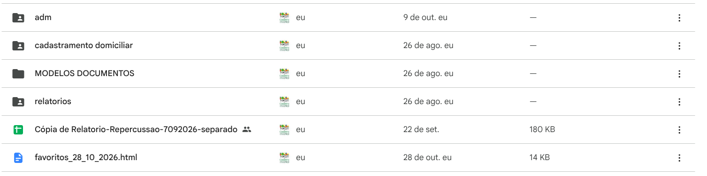

Na raiz do Drive da conta, o trabalho está dividido em cinco pastas principais:
- **`adm`:** Fichas administrativas do Bolsa Família geradas a partir de formulário.
- **`cadastramento domiciliar`:** Solicitações de visita em domicílio, roteirização e termos.
- **`relatorios`:** Reúne a planilha consolidada (`Gestão Mensal de Atendimentos`), a planilha de links da fila (`Config_Postos_CadUnico`), os `modelos originais` e as pastas mensais de cada posto.
- **`avaliacao atendimento`:** Pesquisa de satisfação dos munícipes e painéis gerenciais mensais por servidor.
- **`MODELOS DOCUMENTOS`:** 20 modelos de termos, declarações, encaminhamentos e a planilha `BAIRROS X CRAS.xlsx`.

### Repositório do Painel Web e Manual Online
- **Painel de Fila:** `https://viniciusulpicio.github.io/cadunico_recepcao/`
- **Manual Imprimível Online:** `https://viniciusulpicio.github.io/cadunico_recepcao/manual`
- **Repositório GitHub:** `https://github.com/Viniciusulpicio/cadunico_recepcao`

---

## 2. Painel de Fila dos Postos (Recepção e Entrevistadores)

Este módulo cuida exclusivamente da **fila de espera em tempo real** entre a recepção e os entrevistadores dos três postos de atendimento.

### Como os Entrevistadores Usam o Painel no Navegador
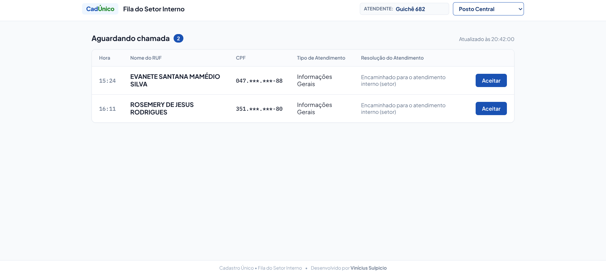

O endereço do painel é `https://viniciusulpicio.github.io/cadunico_recepcao/`. Cada posto pode abrir direto com seu parâmetro:
- Posto Central: `https://viniciusulpicio.github.io/cadunico_recepcao/?posto=central`
- CRAS Teotônio Vilela: `https://viniciusulpicio.github.io/cadunico_recepcao/?posto=teotonio`
- CRAS Rosa Modelli: `https://viniciusulpicio.github.io/cadunico_recepcao/?posto=rosa_modelli`

Quando a recepção cadastra o atendimento na planilha `RECEPCAO` do posto e preenche a coluna G com `"Encaminhado para o atendimento interno (setor)"`, a pessoa entra na fila do painel web. O entrevistador clica em **Aceitar**, atende o cidadão e depois clica em **Finalizar**. A planilha recebe a hora de início, hora de término e o nome do servidor de forma automática.

### Devolução para a Fila e Redirecionamento de Atendimento
Se o entrevistador precisar devolver o atendimento para a fila, o botão **Devolver para a fila** oferece duas opções:
1. **Peguei por engano:** Retorna o cidadão imediatamente para o status `AGUARDANDO`, limpando o nome do entrevistador e o horário de aceite sem alterar os dados originais.
2. **Atendimento incorreto / Redirecionar:** Quando a demanda real do cidadão é diferente da cadastrada na recepção:
   - O sistema finaliza o atendimento atual (`FINALIZADO`) contabilizando para o entrevistador que fez a triagem.
   - Cria automaticamente uma nova linha com status `AGUARDANDO`, mantendo o horário de chegada original da pessoa para não prejudicá-la na fila, e permite selecionar um dos **16 tipos oficiais da planilha** (`Inclusão Cadastral`, `Atualização Cadastral`, `Exclusão da Familia`, `Solicitação Administração do Bolsa Familia`, `Emissão Comprovante CadÚnico`, `Emissão da Carteira da Pessoa Idosa`, `Encaminhamento`, `Solicitação de Atendimento Domiciliar`, `Informações Gerais`, `Não cumprimento de condicionalidades PBF - CRAS`, `Solicitação Desligamento Voluntário PBF`, `Atendimento Telefônico`, `Encaminhamento para outros setores ou políticas publicas`, `WhatsApp - Resposta à Família`, `WhatsApp - Comunicado à Família` ou `WhatsApp - Aviso Prévio de CD`).

### Como Configurar a Planilha `RECEPCAO` de um Novo Mês (Fila Web)

#### 1. Fazer Cópia da Planilha `RECEPCAO`
Vá até a pasta do posto no Google Drive, clique com o botão direito na planilha `RECEPCAO` do mês anterior (ou no modelo `yyyy/xx - RECEPCAO` dentro de `modelos originais`) e selecione **Fazer uma cópia**. Renomeie com o mês novo (exemplo: `2026/11 - RECEPCAO - CENTRAL`) e apague apenas as linhas preenchidas na aba `RECEPÇÃO MENSAL`, preservando o cabeçalho (linhas 1 a 3).

#### 2. Abrir o Apps Script
Com a nova planilha `RECEPCAO` aberta, vá em **Extensões → Apps Script**.
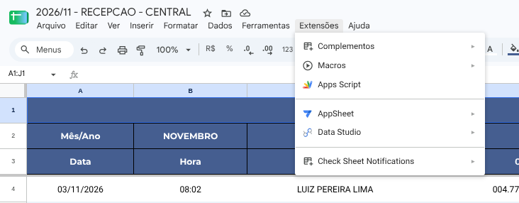

#### 3. Abrir o Menu de Implantação
No canto superior direito, clique em **Implantar → Gerenciar implantações** (ou Nova implantação).
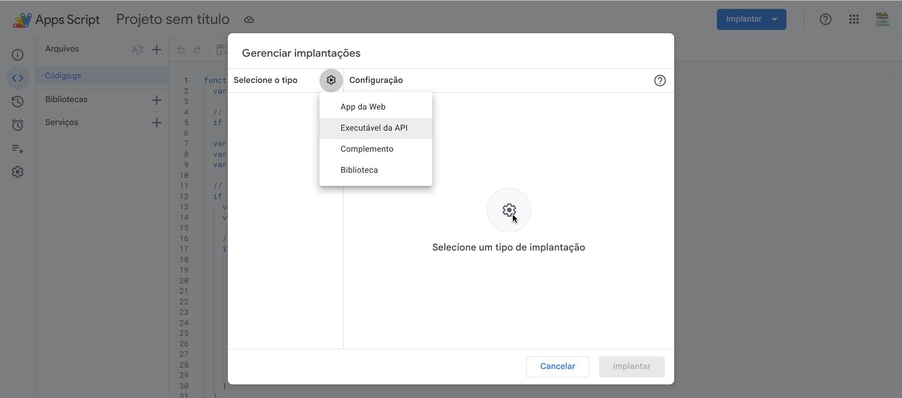

#### 4. Selecionar o Tipo App da Web
Clique no ícone de engrenagem ao lado de "Selecione o tipo" e confirme a opção **App da Web**.
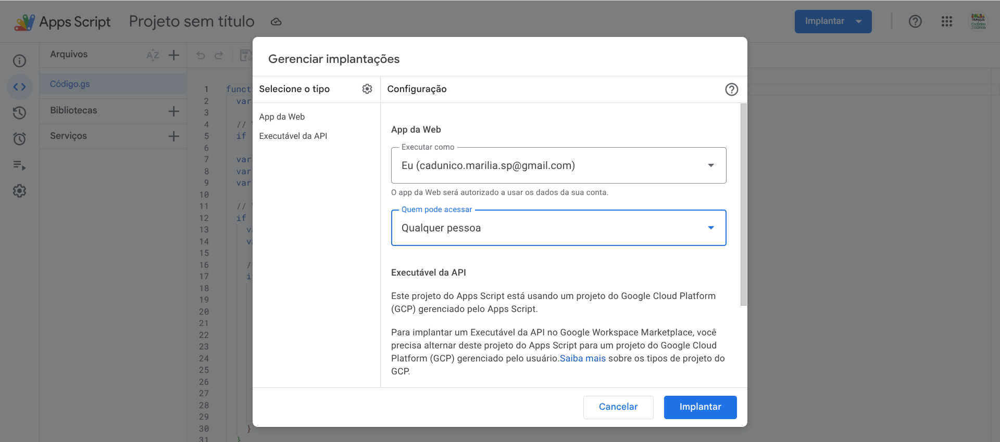

#### 5. Configurar Permissões
Essa etapa é necessária para o site conseguir ler a planilha sem pedir login dos entrevistadores:
- **Executar como:** `Eu (cadunico.marilia.sp@gmail.com)`
- **Quem pode acessar:** `Qualquer pessoa`
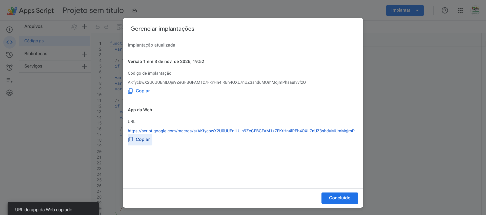

#### 6. Copiar a URL Gerada
Clique em **Implantar** e copie a URL que termina em `/exec`.
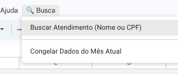

#### 7. Atualizar a Planilha `Config_Postos_CadUnico`
Abra a planilha `Config_Postos_CadUnico` no Drive e cole a URL na linha correspondente ao posto (`central`, `teotonio` ou `rosa_modelli`).
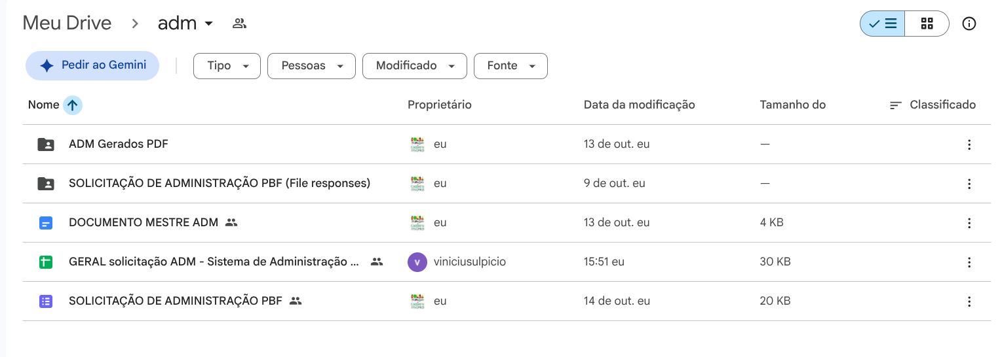

---

## 3. Administração de Benefícios (ADM / Bolsa Família)

Esse sistema gera os processos de desbloqueio, reversão de cancelamento e defesas de condicionalidades. O técnico preenche o formulário com dados e anexos, e o script gera um PDF único juntando o requerimento preenchido aos comprovantes enviados.

### Pasta do Setor no Google Drive


- **`SOLICITAÇÃO DE ADMINISTRAÇÃO PBF`:** Formulário de envio com perguntas cadastrais e campos de upload.
- **`DOCUMENTO MESTRE ADM`:** Arquivo do Google Docs com o modelo do requerimento oficial.
- **`ADM Gerados PDF`:** Pasta onde o script salva os PDFs finais mesclados.
- **`GERAL solicitação ADM`:** Planilha que lista todos os registros recebidos e os links para abrir os PDFs gerados.

### Menu de Controle na Planilha (`⚡ ADM Benefícios`)
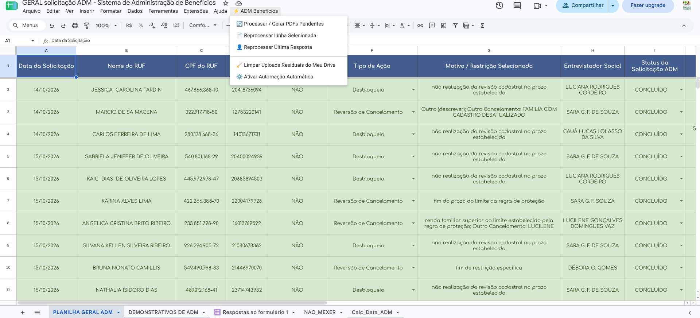

- **Processar / Gerar PDFs Pendentes:** Percorre linhas sem link e tenta gerar o documento novamente. Use se alguém enviar o formulário enquanto o script estiver inativo.
- **Reprocessar Linha Selecionada:** Gera novamente o PDF da linha em que você estiver clicado.
- **Reprocessar Última Resposta:** Força o processamento do último formulário recebido.
- **Limpar Uploads Residuais do Meu Drive:** Move fotos avulsas da raiz do Drive para a pasta correta de respostas.
- **Ativar Automação Automática:** Reconecta o gatilho automático de envio (`onFormSubmit`). Se o formulário for respondido e a planilha não gerar o link do PDF, clique aqui para reativar.

---

## 4. Cadastramento Domiciliar (CD)

Atende pessoas acamadas ou com mobilidade reduzida. O sistema recebe pedidos via formulário, gera os termos com os documentos anexados, organiza as rotas geográficas por bairro e envia mensagem de confirmação para a família no WhatsApp.

### Pasta no Google Drive
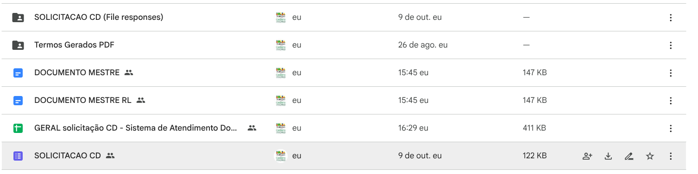

- **`SOLICITACAO CD`:** Formulário para inclusão de novos pedidos de visita.
- **`DOCUMENTO MESTRE`:** Modelo para titular capaz.
- **`DOCUMENTO MESTRE RL`:** Modelo para titulares com curador, tutor ou responsável legal.
- **`Termos Gerados PDF`:** Pasta onde os termos ficam salvos após a mesclagem.
- **`GERAL solicitação CD`:** Planilha central de controle e roteirização.

### Status e Cores da Planilha Geral
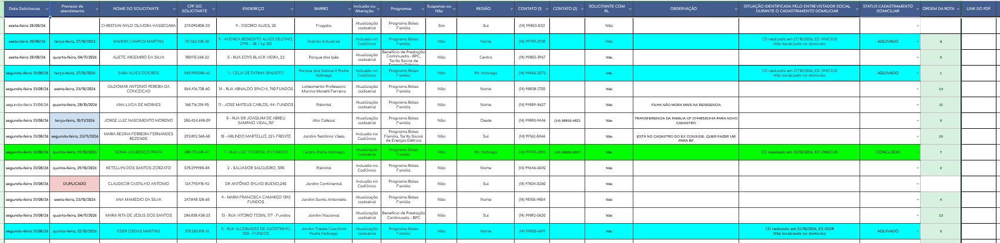

- **Verde (`CONCLUIDO`):** Visita domiciliar feita.
- **Ciano (`AQUIVADO`):** Endereço não localizado, família mudou ou recusou atendimento.
- **Rosa (`DUPLICADO`):** Pedido repetido na triagem.
- **Ordem da Rota:** Posição que o veículo deve seguir na rua durante o itinerário do dia (1 a 14).
- **Link do PDF:** Abre o arquivo pronto para impressão para levar na prancheta de campo.

### Menus de Comando do Cadastramento Domiciliar

#### Menu 1: Emissão de Termos (`⚡ CD Atendimento Domiciliar`)
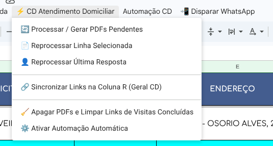
- **Processar / Gerar PDFs Pendentes:** Cria os termos em PDF que ainda não foram gerados.
- **Sincronizar Links na Coluna R:** Restaura os links dos PDFs criados na coluna R.
- **Apagar PDFs e Limpar Links de Visitas Concluídas:** Apaga arquivos pesados de visitas finalizadas para liberar espaço na conta do Google Drive.
- **Ativar Automação Automática:** Reativa o gatilho de formulário caso pare de rodar sozinho.

#### Menu 2: Roteirizador de Visitas (`Automação CD`)
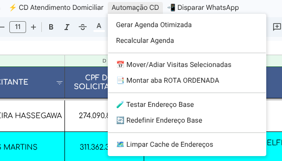
- **Gerar Agenda Otimizada:** Agrupa os atendimentos pendentes partindo do bairro mais distante da sede (`Rua Nelson Spielman, 1294`) e calcula a rota mais curta do dia (limite de 14 visitas na área urbana ou 8 nos distritos).
- **Recalcular Agenda:** Reorganiza datas futuras com base nos novos pedidos recebidos.
- **Mover/Adiar Visitas Selecionadas:** Reprograma as linhas selecionadas para outra data.
- **Montar aba ROTA ORDENADA:** Cria uma aba limpa contendo apenas a folha de bordo do dia, na ordem exata de parada, pronta para imprimir para o motorista e entrevistador.
- **Limpar Cache de Endereços:** Limpa a aba `GeoCache` se algum endereço tiver sido alterado na triagem.

#### Menu 3: Mensagem de WhatsApp (`📲 Disparar WhatsApp`)
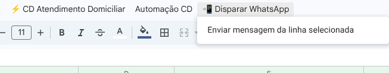
1. Clique na linha da pessoa agendada.
2. Acesse **📲 Disparar WhatsApp → Enviar mensagem da linha selecionada**.
3. Na barra lateral que se abre, clique em **📲 Abrir no WhatsApp Web**.
4. O WhatsApp Web abrirá a conversa com a mensagem pré-preenchida contendo a data da visita e os documentos necessários.

---

## 5. Relatórios Individuais dos Servidores, Fechamento Mensal e Busca

Diferente do Painel de Fila (Seção 2), este módulo controla as **planilhas individuais de produção de cada servidor** (`RELATORIO SERVIDOR` e `RELATORIO CD`) e o painel estatístico consolidado na planilha mestre `Gestão Mensal de Atendimentos`.

### Pasta de Relatórios e Modelos Originais
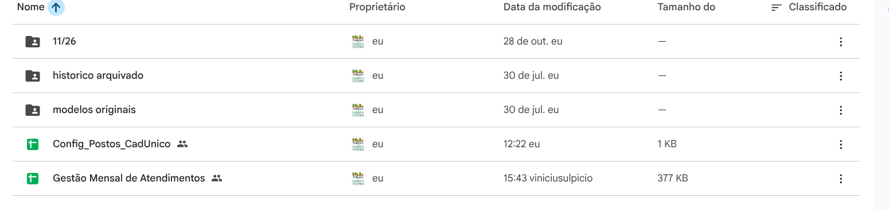

A pasta `modelos originais` guarda as matrizes oficiais que nunca devem ser editadas diretamente, apenas duplicadas:
- `yyyy/xx- RELATORIO SERVIDOR` *(planilha individual de produção de cada entrevistador/técnico)*
- `yyyy/xx - RELATORIO CD` *(planilha de produção das visitas domiciliares)*
- `yyyy/xx - RECEPCAO` *(matriz exclusiva da recepção/fila — ver Seção 2)*
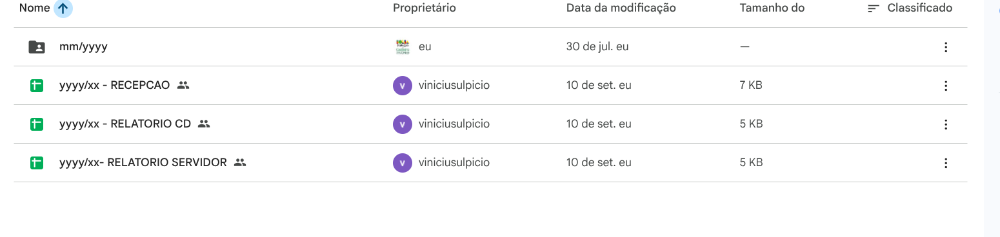

### Como Virar o Mês dos Relatórios dos Servidores e Dashboard
1. **Duplicar as Planilhas dos Servidores:** Duplique a planilha `RELATORIO SERVIDOR` do mês anterior de cada funcionário (ou a pasta inteira do posto do mês anterior, apagando apenas os registros antigos). Diferente da planilha de recepção, as planilhas de relatório individual **não precisam de implantação no Apps Script**.
2. **Vincular na Aba `Configuração Mensal`:** Abra a planilha mestre `Gestão Mensal de Atendimentos`, vá na aba `Configuração Mensal` e cole o link da nova planilha mensal de cada servidor:
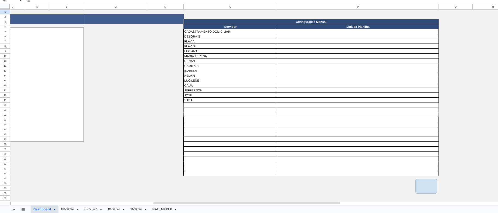
3. **Acompanhar o Dashboard Consolidado:** A aba `Dashboard` soma automaticamente os atendimentos por local (Central, Rosa Modelli, Teotônio Vilela, Domicílio, Ação Itinerante, etc.) e tipo de demanda:
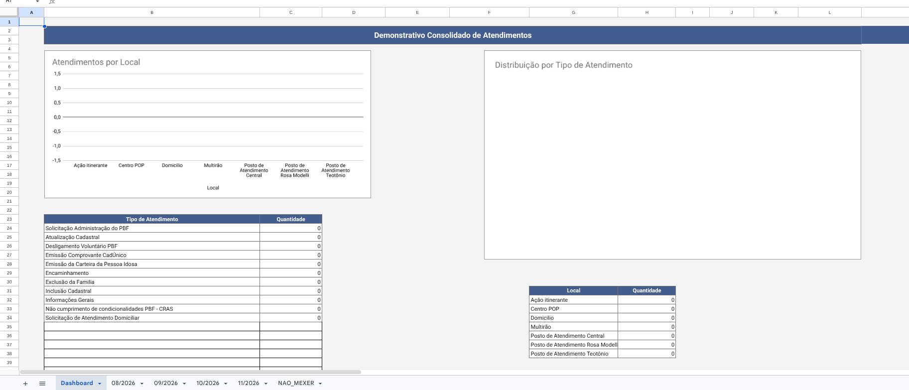

### Rotina Obrigatória: Congelar Dados do Mês Encerrado
As abas mensais trazem os dados das planilhas do mês por meio de fórmulas. Para evitar que os dados mudem ou sumam quando as planilhas antigas forem arquivadas, congele a aba assim que o mês terminar:

1. Abra a planilha `Gestão Mensal de Atendimentos`.
2. Vá até a aba do mês encerrado (exemplo: `10/2026`).
3. Clique em **🔍 Busca → Congelar Dados do Mês Atual**.
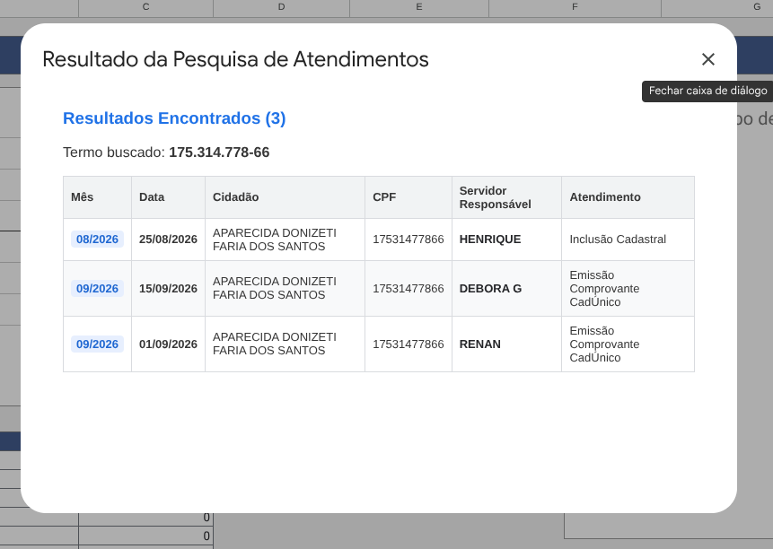
4. Confirme no aviso. O script substituirá as fórmulas por valores fixos.

### Busca Geral por CPF ou Nome
1. Na mesma planilha, vá em **🔍 Busca → Buscar Atendimento (Nome ou CPF)**.
2. Digite o CPF ou parte do nome.
3. O sistema abre uma lista com todas as passagens da pessoa registradas nos meses pesquisados:
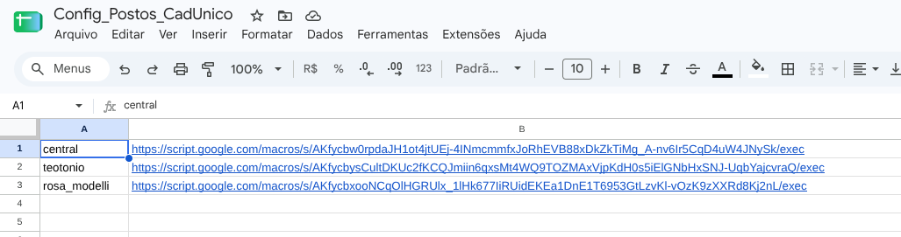

Para incluir um mês novo na busca, abra **Extensões → Apps Script** nessa planilha e adicione o mês no array `abasMensais` (linha 58 do arquivo `codigo.gs`):
```javascript
var abasMensais = ['08/2026', '09/2026', '10/2026', '11/2026'];
```

---

## 6. Avaliação de Atendimento e Desempenho dos Atendentes

Sistema que coleta a opinião do munícipe via formulário e constrói automaticamente painéis mensais com notas de cordialidade, clareza, tempo de espera e resolução da demanda.

### Formulário Respondido pelo Cidadão
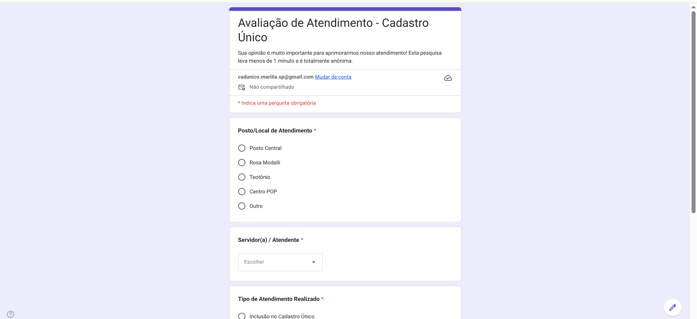

A pesquisa é anônima e rápida (menos de 1 minuto). O munícipe informa o posto, seleciona o atendente na lista e atribui notas de 1 a 5 para cordialidade e clareza, além de registrar se a solicitação foi resolvida.

### Painel Gerencial Global e por Servidor
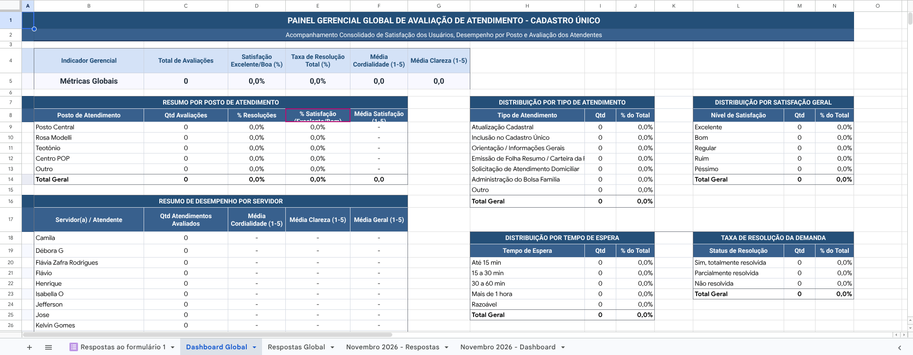

A aba `Dashboard Global` (e as abas clonadas de cada mês) consolida:
- Indicadores globais de satisfação e resolução.
- Desempenho individual por atendente (quantidade de atendimentos e médias de notas).
- Distribuição por tempo de espera e tipo de atendimento.

### Automação Mensal Automática (`onFormSubmit`)
Quando o cidadão envia a avaliação no Google Forms:
1. O script identifica o mês e ano do atendimento (exemplo: `Novembro 2026`).
2. Se for o primeiro envio do mês, ele cria automaticamente as abas `[Mês AAAA] - Respostas` e `[Mês AAAA] - Dashboard` (clonando os gráficos e ajustando as fórmulas para lerem o novo mês).
3. A linha de resposta é gravada na aba do mês correspondente e também na aba global.

### Menus de Comando da Planilha (`📊 Gestão CadÚnico`)
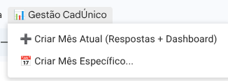
- **➕ Criar Mês Atual (Respostas + Dashboard):** Cria com antecedência o par de abas do mês corrente antes mesmo de entrar a primeira resposta.
- **📅 Criar Mês Específico...:** Permite gerar abas para meses anteriores ou futuros digitando o nome do mês e o ano.

---

## 7. Modelos de Documentos Oficiais, Territorialização e Formulário Verde F1

Na pasta `MODELOS DOCUMENTOS` do Google Drive estão padronizados os 20 arquivos editáveis (`.odt`, `.docx` e `.doc`) de uso diário:
- **Declarações e Termos:** Declaração de Residência (Titular e Responsável Legal), Declaração de Comparecimento, Termo de Renda e Composição Familiar, Termo de Família Unipessoal (Titular e RL) e Requerimento de Troca de RF.
- **Exclusão e Desligamento:** Ficha de Exclusão de Pessoa, Ficha de Exclusão da Família, Termo de Responsabilidade de Exclusão BPC e Declaração de Desligamento Voluntário do PBF.
- **Encaminhamentos para a Rede:** CRAS, Centro POP, INSS/BPC, Educação e Encaminhamento Genérico.
- **Abrangência dos CRAS (`BAIRROS X CRAS.xlsx`):** Tabela oficial que vincula cada bairro de Marília ao seu respectivo CRAS de referência.
- **Formulário Verde F1 Digital (`formulario_verde`):** Matrizes em alta definição do Formulário Principal F1 prontas para preenchimento em tela (`FORMULARIO_VERDE_F1_PREENCHIVEL.pdf`) ou impressão (`FORMULARIO_VERDE_F1_OFICIAL_DOCS.docx`).

---

## 8. Backup Automático Diário e Recuperação de Desastres

Para proteger o setor contra invasão da conta Google, exclusão maliciosa ou perda acidental de planilhas e códigos, todo o sistema conta com uma rotina externa automatizada de backup diário executada às **03:00 da manhã** sob custódia técnica.

### O que o Backup Preserva Automaticamente
1. **Espelho Integral do Google Drive (Protegido Contra Exclusão):** Todas as pastas (`adm`, `avaliacao atendimento`, `cadastramento domiciliar`, `MODELOS DOCUMENTOS` e `relatorios`), planilhas mensais, documentos mestre e PDFs são salvos diariamente mantendo a mesma estrutura do Drive. A rotina nunca apaga arquivos anteriores: mesmo que alguém invada a conta do Google Drive e exclua tudo na nuvem, as cópias permanecem intactas no servidor de backup.
2. **Todos os 80+ Scripts (`.gs` / `.html`) Junto de Suas Planilhas:** Mesmo que os projetos no Google Apps Script tenham o nome genérico `"Projeto sem título"`, o extrator automático lê o vínculo oficial (`parentId`) da planilha dona e salva os códigos dentro da pasta **`Nome da Planilha [SCRIPT]/`** exatamente ao lado do arquivo `.xlsx` correspondente.
3. **Histórico de Versões e Pacotes Diários/Mensais:** Toda vez que uma planilha é alterada, a versão anterior é arquivada separadamente com data e hora, além de pacotes completos fechados dos últimos 30 dias e de todos os meses encerrados.

### Como Solicitar Restauração em Caso de Perda ou Invasão
Caso qualquer planilha, fórmula ou script seja apagado ou corrompido no Google Drive, basta entrar em contato com o responsável técnico (Seção 10) informando qual planilha ou pasta precisa ser restaurada para receber imediatamente o arquivo `.xlsx` íntegro e o código Apps Script correspondente.

---

## 9. O que Fazer se Alguma Coisa Der Errado

| Ocorrência | Onde Olhar | Como Resolver |
| :--- | :--- | :--- |
| O formulário do ADM ou do CD recebeu resposta, mas a planilha não gerou o PDF | Gatilho automático desarmado | Abra a planilha e clique no menu do setor em **Ativar Automação Automática**. Autorize as permissões da conta Google. |
| O painel de fila no site não carrega a lista de pessoas | Permissão de acesso do Apps Script | Na planilha `RECEPCAO` do posto, vá em **Implantar → Gerenciar implantações**, clique no lápis de editar e confirme se está com **Quem pode acessar: Qualquer pessoa**. Copie a URL e cole na `Config_Postos_CadUnico`. |
| O Google Drive avisou que o armazenamento de 15 GB está no fim | Excesso de xerox antigas no Drive | Na planilha de CD, acione o menu **⚡ CD Atendimento Domiciliar → Apagar PDFs e Limpar Links de Visitas Concluídas**. Em seguida, esvazie a lixeira do Drive da conta. |
| O roteirizador do CD não traça rota ou para com erro | Endereço com número incorreto ou fora de Marília | Verifique se o endereço da solicitação tem o formato `Rua Nome da Rua, 123`. Corrija a célula e use **Automação CD → Limpar Cache de Endereços**. |
| A planilha de Gestão Mensal demora muito para abrir | Fórmulas de meses passados ainda ativas | Vá na aba do mês anterior e execute o menu **Busca → Congelar Dados do Mês Atual**. |
| Uma planilha, fórmula ou script foi apagado ou corrompido no Google Drive | Backup Diário Externo | Entre em contato com o responsável técnico abaixo para receber o arquivo `.xlsx` e a pasta `[SCRIPT]` restaurados a partir do backup diário. |

---

## 10. Suporte Técnico e Contato do Desenvolvedor

Caso precise recuperar planilhas ou scripts apagados a partir do backup diário, restaurar o ambiente em caso de invasão da conta Google, ajustar o painel web de fila ou tirar dúvidas técnicas sobre o funcionamento das automações, entre em contato:

- **Responsável Técnico / Desenvolvedor:** Vinícius Sulpicio
- **E-mail:** `viniciusulpicio@gmail.com`
- **GitHub / Código-Fonte:** `https://github.com/Viniciusulpicio/cadunico_recepcao`
